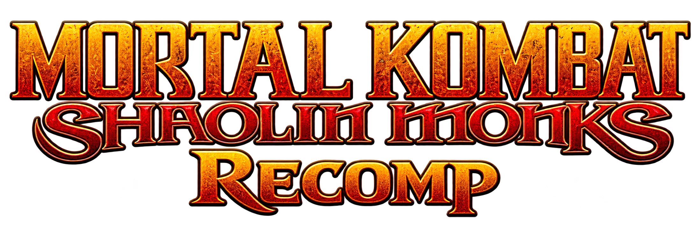

# Shaolin Monks Recomp

## Viewer release package: v1.0.0

[Download the Windows x64 ZIP](release/v1.0.0/ShaolinMonksViewer-v1.0.0-Windows-x64.zip) | [SHA-256 checksums](release/v1.0.0/SHA256SUMS.txt) | [Release notes](release/v1.0.0/RELEASE_NOTES.md) | [Provenance](release/v1.0.0/PROVENANCE.json)

The `release/v1.0.0/` folder contains the existing standalone **Shaolin Monks Viewer** build from **2026-10-19 (UTC)**, copied without changing the ZIP bytes. The download is **0.734 MiB** and expands to **1.459 MiB**, including its required runtime files and notices.

Extract the ZIP, run ShaolinMonksViewer.exe, then choose Open game source. You must supply your own original game files: the supported USA/Europe Xbox release of Mortal Kombat: Shaolin Monks, supplied as ISO/XISO or a complete extracted game source. Game images, extracted assets, saves, logs and captures are excluded from the package.

The package includes the executable, player instructions, project GPL text, and XboxXBERecomp, ImGui and miniz notices. Graphics and audio use Windows Direct3D 11, D3DCompiler and XAudio2 facilities; no third-party runtime DLL is packaged.

**Build provenance:** `v1.0.0` is the repository package label. This is an existing October build, not a fresh rebuild. The executable has no embedded application version or source-commit identifier. The recorded source snapshot documents the source present during release preparation; it does not prove that the binary was compiled from that snapshot. A final Git tag and GitHub Release have not been created; source-tag mapping is pending.

This is the standalone asset viewer. ShaolinMonksRecomp.exe is the separate game recompilation and is not included. The adjacent unversioned extracted viewer folder and the default build/viewer executable are older than this ZIP; they were not used.

---

  

  
  
  
  

> [!IMPORTANT]
> Shaolin Monks Recomp does not include the original game or its assets.
> You must provide your own legally obtained **USA/Europe Xbox copy of Mortal Kombat: Shaolin Monks**.

**A native Windows PC port of Mortal Kombat: Shaolin Monks, made through static recompilation.**

The original Xbox code runs directly on the PC, without an Xbox emulator, with graphics through Direct3D 12.
The port adds resolution and render scale settings, display modes, keyboard and mouse input, and remappable controller buttons.

The campaign is playable from start to finish. Some graphical issues remain, with fixes planned for future builds.

**Bonus content:** **Mortal Kombat II** and **The Suffering Demo** are not playable yet. Support is planned for a future update.

## System requirements

| Component | Requirement |
| --- | --- |
| CPU | x64 processor with SSE4.2 and POPCNT |
| GPU | Direct3D 12-compatible GPU |
| Input | Keyboard and mouse, or a compatible controller |
| Game files | Original USA/Europe Xbox release |

## Platform support

| Operating system | Status |
| --- | --- |
| Windows 10 x64, version 1903 or later | Supported |
| Windows 11 x64 | Supported |
| Linux x86_64 | Coming soon |
| macOS | Not supported yet |

## Getting started

1. Extract the Windows release ZIP.
2. Run `ShaolinMonksRecomp.exe`.
3. Select your ISO, XISO, ZIP, extracted game folder, or `default.xbe`.
4. Choose your settings, then select **Save and Play**.

ISO and XISO images are read directly. ZIP contents are imported once.
Keep the selected image or complete game folder available. You can change it in the launcher's **Files and support** tab.

## Standalone 3D viewer

The separate `ShaolinMonksViewer.exe` browses original character meshes, joints, and named animation clips,
with playback controls, frame scrubbing, camera controls, and binary FBX/PNG export.
FBX saves the visible pose, normals, UVs, vertex colors, materials, and external
diffuse PNG textures; skeleton and animation export are not implemented.
**Character Debug** replaces the stage selector while browsing characters. It adds
an original checker-textured floor with one-meter squares and black distance fog.
Use WASD/arrows to move, hold Right Shift to run, and press Space to jump.
J/K/L send quick/power/launch inputs, U throws, E modifies J/K/L for specials,
and I sends E+J. Compatible characters use their original input
graphs, source timing, buffered links and authored attack travel. The inspector
also provides direct clip previews. Target/hit/unlock-dependent branches remain
disabled without the corresponding combat simulation; full gameplay parity is
not established. The initial camera looks from left to right.
Modern character-specific movement clips take priority over retargeted fallbacks;
legacy banks use compatible preview motions where available. Shared motions retain
the selected rig's limb lengths, with blended transitions and foot-based grounding.
Normal jumps read the original executable's launch,
gravity, early-release, and air-steering parameters and use a fixed-step controller.
Hold Space for a full jump or release early for a short standing jump. Isolated
native-routine comparisons cover normal jump motion; full gameplay controls and
animation-transition parity remain unverified.
Click meshes to highlight them, press F to focus the selection, and navigate
with mouse drags and the wheel. Up/Down loads stages from the focused library list.
The right hierarchy, beside the inspector, groups objects and materials and keeps selection synchronized
with the viewport.
The stage dropdown selects campaign maps, versus arenas, and extra map resources.
**Stage BGM** starts enabled and plays the area's original base music cue when a
stage is selected. Uncheck it in the stage inspector to stop music; the volume
slider below it adjusts playback from 0 to 100%. Switching stages preserves the
camera position, rotation, and zoom. Use F or Frame asset to reframe.
Scenery playback animates original texture scrolling and supported mesh tracks,
with timeline scrubbing and selectable animation groups.
Environment particle previews read the game's shared sprite and command bank.
Inferred flame anchors start enabled; the particle inspector can attach other
commands to a selected stage object. Supported velocity/gravity uses recovered
60 Hz steps; particle flags control fades, size, sprite frames and alpha/add/subtract
blending. Placement and full emission scheduling remain approximate;
gameplay emitter scripts and collision behavior are not executed.
Stage lighting reads source light records and preserves baked vertex illumination.
Modern material channels include diffuse, reflection and gloss textures, UV transforms,
and independent wrap/clamp, with mipmaps and anisotropic filtering. Reflections and
dynamic light selection/shading remain previews of the original shader pipeline.
Stage previews include additive light/fog blending and smooth effect fades.
Planar vertex-alpha shadows fade without acquiring the fog color. Separate eye/glow
layers stay unlit. **Lighting** and **Bloom (preview)** start enabled, with glow
strength 0.8 and threshold 0. Fire and recognized glow/light-shaft layers feed bloom.
Transparent foreground layers attenuate glow behind them.
This is an approximation; the original full-screen bloom behavior is unverified.
Source background-opacity flicker keeps supported fog sheets translucent.
Compact stages receive smoothed generated normals with sharp creases retained.
Mesh details identify flagged shadow receivers, inferred shadow overlays, and camera/helper volumes. Legacy
surface-orientation repair fixes missing faces caused by inconsistent strip winding.
Animation controls include playback FPS, elapsed time, and dynamic flap joints using
spring defaults recovered from the supplied executable. Character previews add an
adjustable directional light and filtered shadows; Character Debug uses Right Shift
to run and Space to jump. Gameplay spring collision volumes and scripted overrides
are not reproduced.
Atmosphere controls add original fog presets, stage background colors, and
camera-relative sky domes with their original textures.
The Concept Art section adds thumbnail browsing and PNG export for original gallery artwork.
It reads your own game source directly. See [viewer instructions and preview limits](docs/VIEWER.md).

## Controls

Xbox, PlayStation, and other SDL-compatible controllers support connection and disconnection during play.
DualShock 4 works through USB or Bluetooth. The game displays Xbox button prompts.

| Xbox input | Keyboard | Mouse | PlayStation |
| --- | --- | --- | --- |
| Left stick | W / A / S / D | - | Left stick |
| Direction pad | Arrow keys | - | Direction pad |
| A | Space | - | Cross |
| B | Esc or Ctrl | Right button | Circle |
| X | J | Left button | Square |
| Y | K | Middle button | Triangle |
| White | Q | Side button 2 | L1 |
| Black | C | Side button 1 | R1 |
| Left trigger | Shift | - | L2 |
| Right trigger | E | - | R2 |
| Start | Enter | - | Options |
| Back | Backspace | - | Share |
| Right stick | - | Movement | Right stick |
| FPS and frame time | F9 | - | - |
| Release / capture pointer | F10 | Click to capture | - |

See [controller settings](docs/CONTROLLERS.md) for mappings, vibration, and connection details.

## Languages

| Language | Interface | Subtitles | Voice acting |
| --- | --- | --- | --- |
| English | Yes | Yes | Yes |
| French | Yes | Yes | Yes |
| German | Yes | Yes | Yes |
| Spanish | Yes | Yes | Yes |
| Italian | Yes | Yes | Yes |
| Brazilian Portuguese | Coming soon | Coming soon | Coming soon |

## User files

| Data | Default location |
| --- | --- |
| Saves | Windows Saved Games folder: `Shaolin Monks\hdd` |
| Configuration | `%LOCALAPPDATA%\Shaolin Monks Recomp\settings.toml` |
| Logs | `%LOCALAPPDATA%\Shaolin Monks Recomp\logs` |
| Crash reports | `%LOCALAPPDATA%\Shaolin Monks Recomp\crashes` |

Error messages identify the session log. Closing the message opens `%LOCALAPPDATA%\Shaolin Monks Recomp`.
Include that log when you report a problem.

## Credits

- [TGP482 / XboxXBERecomp](https://github.com/TGP482/XboxXBERecomp): static recompiler and Xbox runtime.
- [LLVM / Clang](https://llvm.org/): native code compilation.
- [Ghidra](https://github.com/NationalSecurityAgency/ghidra): executable analysis and function inspection.
- [SDL](https://github.com/libsdl-org/SDL): controller input and device detection.
- [Dear ImGui](https://github.com/ocornut/imgui): host interface and performance display.
- [toml++](https://github.com/marzer/tomlplusplus): configuration files.
- [miniz](https://github.com/richgel999/miniz): ZIP imports.
- [xemu](https://xemu.app/), [Cxbx-Reloaded](https://github.com/Cxbx-Reloaded/Cxbx-Reloaded), and [nxdk](https://github.com/XboxDev/nxdk): behavior and ABI references.

See [BUILDING.md](docs/BUILDING.md) to build from source, or [TROUBLESHOOTING.md](docs/TROUBLESHOOTING.md) to report a problem.

## AI usage

The development process uses AI assistance for executable analysis, code changes, debugging, tests, build scripts, and documentation.
The maintainer reviews these contributions. Validation includes automated tests and gameplay checks.

## License

The project code uses **GPL-2.0-or-later**. See [LICENSE](LICENSE), [tools and dependencies](UPSTREAM.md), and [dependency notices](licenses).
The project license does not grant rights to the original game or its artwork.
This project is not affiliated with or endorsed by the owners of Mortal Kombat or Xbox.
